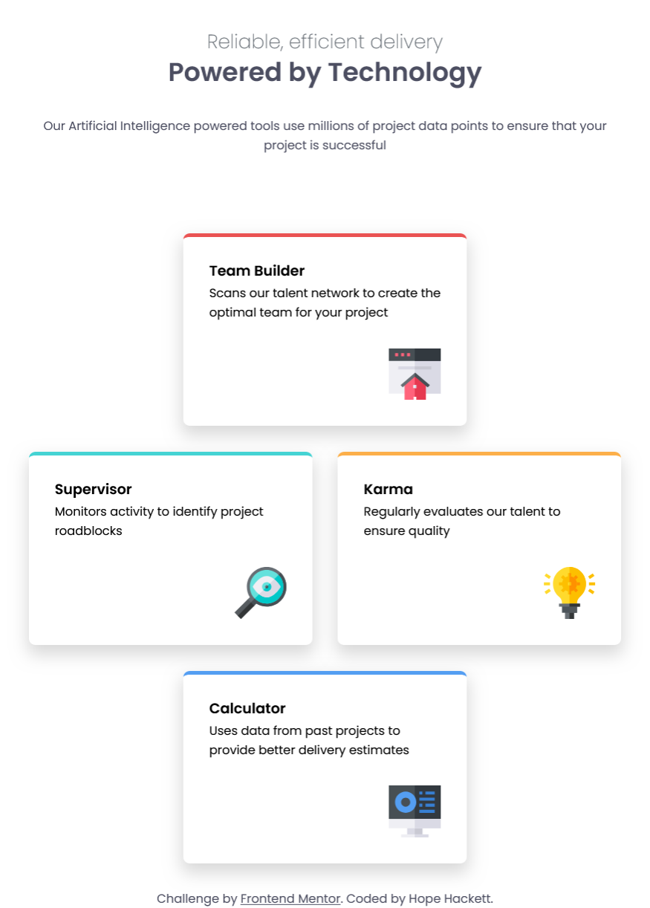

# Frontend Mentor - Four card feature section solution

This is a solution to the
[Four card feature section challenge on Frontend Mentor](https://www.frontendmentor.io/challenges/four-card-feature-section-weK1eFYK).
Frontend Mentor challenges help you improve your coding skills by building
realistic projects.

## Table of contents

- [The challenge](#the-challenge)
- [Screenshot](#screenshot)
- [Links](#links)
- [My process](#my-process)
  - [Built with](#built-with)
  - [What I learned](#what-i-learned)
  - [Continued development](#continued-development)
  - [Useful resources](#useful-resources)
  - [AI Collaboration](#ai-collaboration)
- [Author](#author)
- [Acknowledgments](#acknowledgments)

### The challenge

The challenge was to make 4 cards layout properly, according to the Figma design
in all the difference widths.

### Screenshot

### Links

- Solution URL: [Add solution URL here](https://your-solution-url.com)
- Live Site URL:
  [Add live site URL here](https://adorable-duckanoo-04cc6b.netlify.app/)

## My process

I referred to a site I made while taking Kevin Powell's course on Master.dev and
his CSS Demystified course.

### Built with

- Semantic HTML5 markup
- CSS custom properties
- Flexbox
- CSS Grid
- Mobile-first workflow

### What I learned

I learned how to use grid and flexbox to move these cards into position with
each width change.

### Continued development

I will continue to pursue understanding grid and flexbox.

### Useful resources

As I said earlier Kevin Powell's course on Master.dev was an excellent resource,
as well as his CSS Demystified course.

### AI Collaboration

I used Claude when I got stuck.

## Author

- Frontend Mentor - [@hopeHack](https://www.frontendmentor.io/profile/hopeHack)

## Acknowledgments

Thank you, Kevin Powell and Claude AI.
